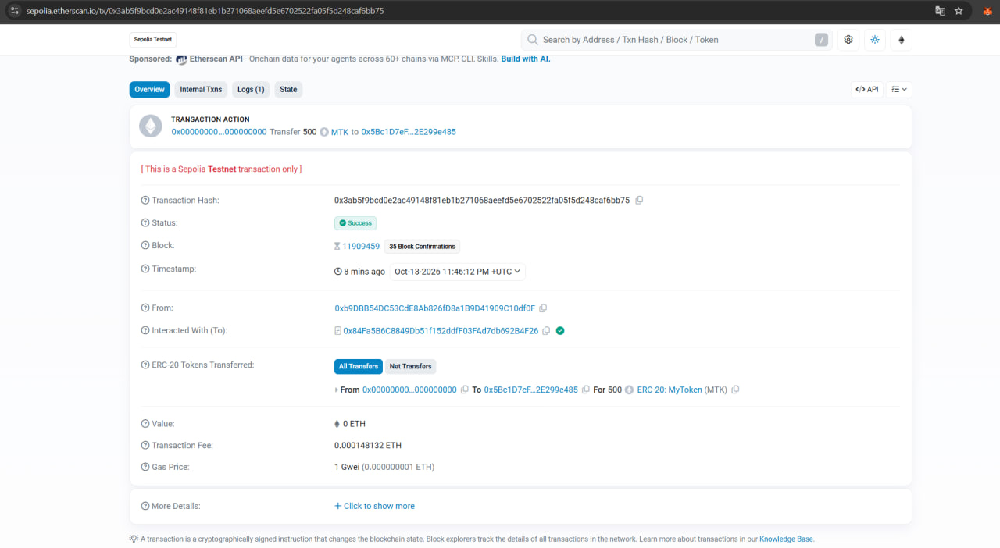
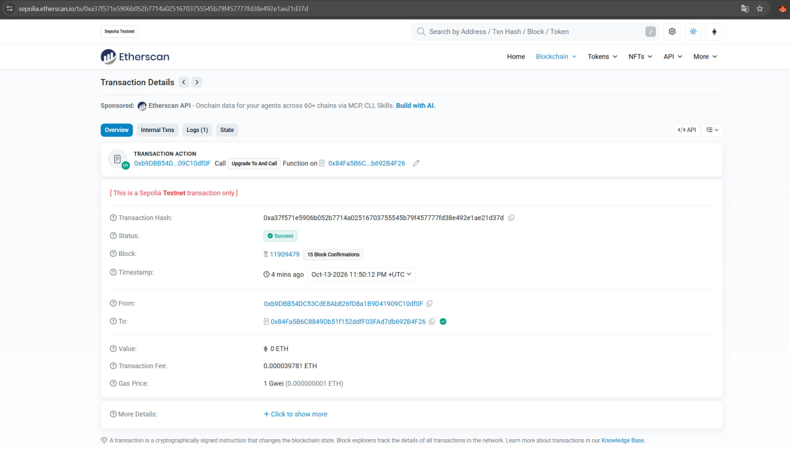
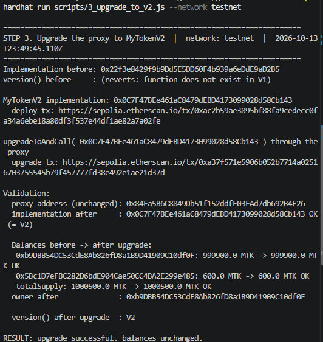

# Upgradeable MyToken (MTK): V1 → UUPS proxy → V2

The ERC20 token from the previous assignment (MyToken, MTK, owner-only `mint`),
made upgradeable with the **UUPS** proxy pattern (OpenZeppelin v5, ERC-1967).

## How it works

```
                 users / MetaMask
                        │  calls (balanceOf, transfer, mint, version, ...)
                        ▼
              ┌───────────────────┐
              │   MyTokenProxy    │  address never changes
              │  stores ALL state │  balances, supply, owner
              └─────────┬─────────┘
                        │ delegatecall
          before        ▼          after upgradeToAndCall()
     ┌──────────────┐        ┌──────────────┐
     │  MyTokenV1   │  ───▶  │  MyTokenV2   │
     │ logic only   │        │ V1 + version │
     └──────────────┘        └──────────────┘
```

| Contract | Role |
|---|---|
| [`contracts/MyTokenV1.sol`](contracts/MyTokenV1.sol) | ERC20 V1 implementation: `initialize`, owner-only `mint`, UUPS `_authorizeUpgrade` (owner only) |
| [`contracts/MyTokenProxy.sol`](contracts/MyTokenProxy.sol) | ERC-1967 proxy: stores state, delegates every call to the current implementation |
| [`contracts/MyTokenV2.sol`](contracts/MyTokenV2.sol) | ERC20 V2 implementation: inherits V1 unchanged and adds `version()` returning `"V2"` |

**Why UUPS:** the upgrade function (`upgradeToAndCall`) lives in the implementation,
so the proxy stays minimal and cheap, and only the token owner can upgrade.

**Storage layout:** V2 inherits V1 without changes and adds no state variables.
OpenZeppelin v5 upgradeable contracts keep their data in ERC-7201 namespaced slots,
and the implementation address sits in the ERC-1967 slot, so nothing can collide.
The test suite checks compatibility with `upgrades.validateUpgrade(V1, V2)`.

## Setup

```bash
npm install
npx hardhat test        # 16 tests: V1 behaviour, upgrade, balances, version()
```

Configure the testnet (values are stored outside the project, never committed):

```bash
npx hardhat vars set TESTNET_PRIVATE_KEY   # private key of the MetaMask test account (owner)
npx hardhat vars set TESTNET_RPC_URL       # optional, default: public Sepolia RPC
```

## Deployment steps

Each script prints explorer links and appends its output to `logs/<network>.log`.
Addresses are saved to `deployments/<network>.json` and read by the next script.

| Step | Command | What happens |
|---|---|---|
| 1 | `npx hardhat run scripts/1_deploy_v1.js --network testnet` | deploys MyTokenV1 (logic) and MyTokenProxy pointing to it; `initialize` mints 1,000,000 MTK to the owner |
| 2 | `npx hardhat run scripts/2_mint_transfer_v1.js --network testnet` | through the V1 proxy: owner mints 500 MTK to `RECIPIENT` and transfers 100 MTK to it |
| 3 | `npx hardhat run scripts/3_upgrade_to_v2.js --network testnet` | deploys MyTokenV2, calls `upgradeToAndCall` on the proxy, compares balances before/after, calls `version()` |
| 4 | `npx hardhat run scripts/4_check.js --network testnet` | read-only: current implementation, balances, `version()` |
| 5 | `npx hardhat run scripts/5_verify.js --network testnet` | optional: verify source code on Etherscan (needs `ETHERSCAN_API_KEY`) |

`RECIPIENT` is the second MetaMask account. Set it before step 2:

```powershell
$env:RECIPIENT="0x..."      # Windows PowerShell
```
```bash
export RECIPIENT=0x...      # macOS / Linux
```

The same scripts run on a local network: start `npx hardhat node` in one terminal
and use `--network localhost` in another.

## Deliverables

### Contracts on Sepolia

| Contract | Address |
|---|---|
| MyTokenProxy (token address) | [0x84Fa5B6C8849Db51f152ddfF03FAd7db692B4F26](https://sepolia.etherscan.io/address/0x84Fa5B6C8849Db51f152ddfF03FAd7db692B4F26) |
| MyTokenV1 implementation | [0x22f3e8429f9b9Dd5E5DD60F4b939a6eDdE9aD2B5](https://sepolia.etherscan.io/address/0x22f3e8429f9b9Dd5E5DD60F4b939a6eDdE9aD2B5) |
| MyTokenV2 implementation | [0x0C7F47BEe461aC8479dEBD4173099028d58Cb143](https://sepolia.etherscan.io/address/0x0C7F47BEe461aC8479dEBD4173099028d58Cb143) |

### 1. Mint and transfer on the V1 proxy

Owner `0xb9DBB54DC53CdE8Ab826fD8a1B9D41909C10df0F` → recipient (second MetaMask account) `0x5Bc1D7eFBC282D6bdE904Cae50CC4BA2E299e485`.

- Mint 500 MTK: https://sepolia.etherscan.io/tx/0x3ab5f9bcd0e2ac49148f81eb1b271068aeefd5e6702522fa05f5d248caf6bb75
- Transfer 100 MTK: https://sepolia.etherscan.io/tx/0x17b52fce1d8942a1a2069901a90c38f76cf0e7bab290ce96022d8f178fbe2c13



### 2. Upgrade transaction

- V2 implementation deployment: https://sepolia.etherscan.io/tx/0xac2b59ae3895bf88fa9cedecc0fa34a6ebe18a80df3f537e44df1ae82a7a02fe
- Upgrade transaction (`upgradeToAndCall`, emits `Upgraded(0x0C7F…b143)`): https://sepolia.etherscan.io/tx/0xa37f571e5906b052b7714a02516703755545b79f457777fd38e492e1ae21d37d



### 3. Balances after the upgrade

| Account | Before upgrade (V1) | After upgrade (V2) |
|---|---|---|
| Owner `0xb9DB…df0F` | 999,900 MTK | 999,900 MTK |
| Recipient `0x5Bc1…e485` | 600 MTK | 600 MTK |
| Total supply | 1,000,500 MTK | 1,000,500 MTK |


### 4. `version()` after the upgrade

Before the upgrade `version()` reverts (the function does not exist in V1); after it, the call through the proxy returns `"V2"`.



### Logs

Full output of all scripts: [`logs/testnet.log`](logs/testnet.log)
